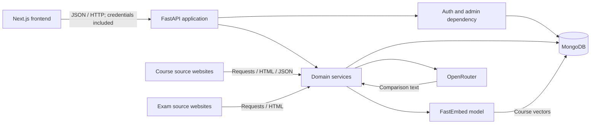
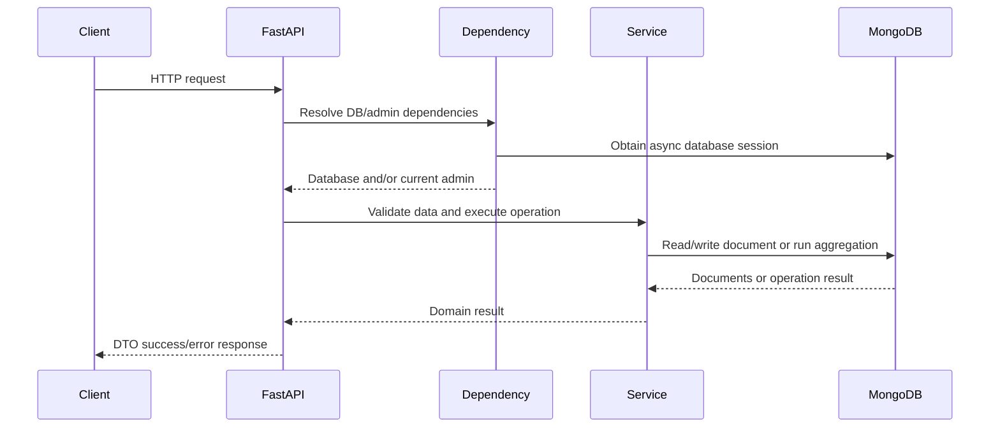
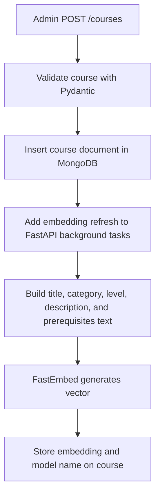
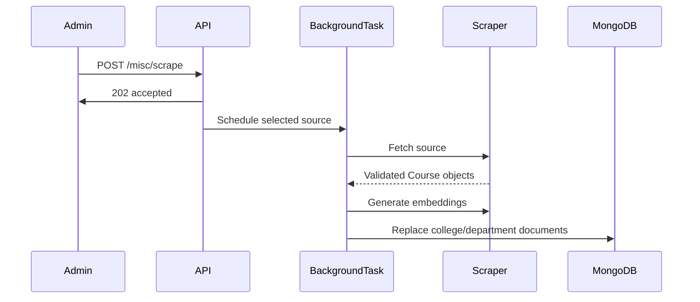
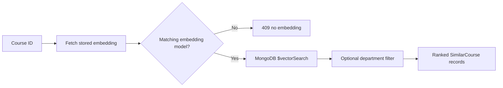
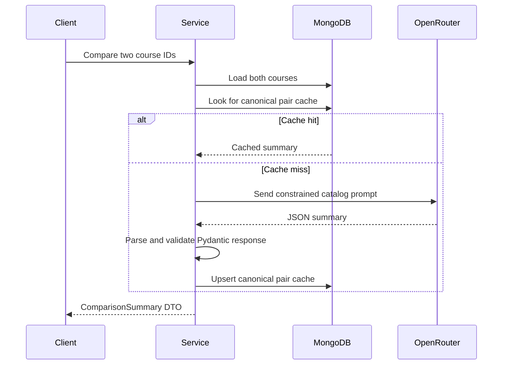
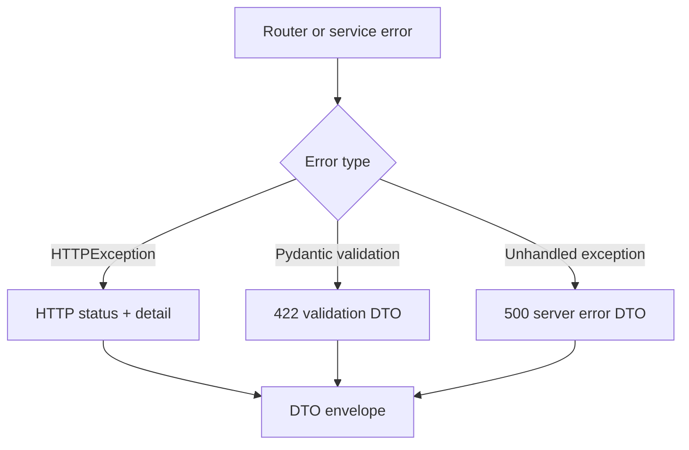

# UniScope Backend

UniScope is a FastAPI backend for university course discovery and exam
information. It maintains a MongoDB course catalog, generates local vector
embeddings for semantic course search, scrapes course and exam data from
configured sources, and uses OpenRouter to generate cached course-comparison
summaries.

The API is consumed by the Next.js frontend and is documented interactively at
`/docs` (Swagger UI) and `/redoc` when the server is running.

## Technology Stack

| Technology | Role in the system |
|---|---|
| Python 3.13+ | Backend runtime |
| FastAPI / Starlette | Async HTTP application, routing, dependencies, middleware, and lifecycle management |
| Pydantic v2 / Pydantic Settings | Request/response validation and environment configuration |
| MongoDB async PyMongo | Persistent storage, aggregation, transactions, and Atlas Vector Search |
| FastEmbed | Local generation of text embeddings for courses |
| OpenRouter SDK | OpenRouter Responses API access for AI course comparisons |
| PyJWT | Signing and validating short-lived admin session JWTs |
| pwdlib with Argon2 | Password hashing and verification |
| Requests / Beautiful Soup / lxml | HTTP scraping and HTML/JSON catalog extraction |
| Uvicorn / FastAPI CLI | ASGI server and development runner |

The frontend is not hosted by this service. It is a separate Next.js application
that calls this API and sends the browser's `access_token` cookie with
authenticated requests.

## System Architecture



The backend is organized in layers:

1. **Application layer** - `main.py` constructs the FastAPI app, CORS policy,
   exception handlers, lifecycle hooks, and API routers.
2. **API/transport layer** - `api/routers/` validates HTTP inputs and maps
   domain results to DTO responses and status codes.
3. **Dependency layer** - `api/dependencies.py` provides the async MongoDB
   session and authenticated admin.
4. **Domain/service layer** - `service/` implements authentication, course
   management, embeddings, exam timelines, scraping replacement, statistics,
   and AI comparisons.
5. **Persistence layer** - `core/database.py` owns the process-wide async
   MongoDB client and database lifecycle.
6. **Data and integration layer** - `models/` defines Pydantic schemas;
   `scrapers/` and `exam_scrapers/` define source adapters.

### Request pipeline



All HTTP exceptions, Pydantic validation errors, and unhandled exceptions are
converted into a consistent DTO envelope by `api/exception_handlers.py`.

## Project Structure

```text
backend/
├── main.py                 FastAPI app, lifecycle, middleware, routers
├── core/
│   ├── config.py           Environment-backed settings
│   └── database.py         Async MongoDB client and startup/shutdown
├── api/
│   ├── dependencies.py     DB and admin authentication dependencies
│   ├── exception_handlers.py
│   └── routers/            HTTP route definitions
├── service/                Domain logic and external integrations
├── models/                 Pydantic API and MongoDB document schemas
├── scrapers/
│   ├── base_scraper.py     Shared course scraper behavior
│   ├── registry.py         College/department source registry
│   └── strategies/         Institution-specific course sources
└── exam_scrapers/
    ├── base_scraper.py     Shared exam scraper behavior
    ├── registry.py         Exam/year source registry
    └── strategies/         GATE/JAM timeline sources
```

## Quick Start

### Prerequisites

- Python 3.13 or newer
- [uv](https://docs.astral.sh/uv/)
- MongoDB with a database name in the connection URI

MongoDB Atlas Vector Search is required for the vector-similarity endpoint.
Replica-set or `mongos` MongoDB deployments enable atomic course refresh
transactions. A standalone MongoDB deployment can store and query the catalog,
but scraper refreshes fall back to delete-then-insert replacement.

### Run locally

From the repository root:

```bash
cd backend
cp .env.example .env  # create this file if it does not already exist
uv sync
uv run fastapi dev
```

The API is available at `http://localhost:8000`; interactive API documentation
is available at `http://localhost:8000/docs`.

Example `.env`:

```env
PROJECT_NAME=UniScope Backend
DATABASE_URI=mongodb://localhost:27017/uniscope
SECRET_KEY=replace-with-a-long-random-secret
ALGORITHM=HS256
ACCESS_TOKEN_EXPIRE_MINUTES=30
ROOT_USERNAME=root
ROOT_PASSWORD=change-this-password
FRONTEND_URL=http://localhost:3000

EMBEDDING_MODEL=BAAI/bge-small-en-v1.5
EMBEDDING_DIMENSIONS=384
EMBEDDING_CACHE_DIR=.cache/fastembed
VECTOR_INDEX_NAME=course_vec

OPENROUTER_API_KEY=
OPENROUTER_MODEL=openrouter/free
LLM_TIMEOUT_SECONDS=60
LLM_MAX_ATTEMPTS=3
```

`DATABASE_URI` must include both a host and a database name. `SECRET_KEY` must
be configured before issuing or validating JWT cookies. `OPENROUTER_API_KEY`
is only required for AI comparison summaries.

## Configuration

| Setting | Default | Purpose |
|---|---|---|
| `PROJECT_NAME` | `UniScope Backend` | FastAPI title |
| `DATABASE_URI` | empty | MongoDB URI, including the database name |
| `SECRET_KEY` | empty | JWT signing key |
| `ALGORITHM` | `HS256` | JWT algorithm |
| `ACCESS_TOKEN_EXPIRE_MINUTES` | `30` | Session cookie lifetime |
| `ROOT_USERNAME` | `root` | Immutable startup-created administrator |
| `ROOT_PASSWORD` | `root` | Initial root password; use a secret value in deployments |
| `FRONTEND_URL` | `http://localhost:3000` | Allowed CORS origin |
| `EMBEDDING_MODEL` | `BAAI/bge-small-en-v1.5` | FastEmbed model |
| `EMBEDDING_DIMENSIONS` | `384` | Embedding size and vector-index dimension |
| `EMBEDDING_CACHE_DIR` | `.cache/fastembed` | FastEmbed model cache |
| `VECTOR_INDEX_NAME` | `course_vec` | MongoDB Vector Search index name |
| `OPENROUTER_API_KEY` | empty | OpenRouter credential |
| `OPENROUTER_MODEL` | `openrouter/free` | Model selector/routing preference |
| `LLM_TIMEOUT_SECONDS` | `60` | Per-request AI timeout |
| `LLM_MAX_ATTEMPTS` | `3` | AI generation attempts, including retries |

Settings are loaded from `.env` by Pydantic Settings and environment variables
override file values.

## Startup and Database Lifecycle

The FastAPI lifespan performs startup in this order:

1. Load and validate the FastEmbed model.
2. Connect lazily to MongoDB through `AsyncMongoClient`.
3. Create missing `admins`, `courses`, `exam_events`, and
   `comparison_summaries` collections.
4. Create the root admin only if it is not already present.
5. Create or update the `course_vec` vector-search index on `courses`.
6. Yield control to the application.
7. Close the shared MongoDB client during shutdown.

The MongoDB client is process-wide and reused across FastAPI requests. The
database is resolved from the database name in `DATABASE_URI`.

### MongoDB collections

| Collection | Purpose |
|---|---|
| `admins` | Administrator usernames and Argon2 password hashes |
| `courses` | Canonical course records plus `embedding` and `embedding_model` |
| `exam_events` | Ordered GATE/JAM timeline events for each exam and year |
| `comparison_summaries` | Cached AI summaries keyed by canonical course-ID pair |

## Authentication and Authorization

Admin authentication uses an `access_token` HttpOnly cookie. Login verifies an
Argon2 password hash and creates a signed JWT containing:

- `sub`: MongoDB admin document ID
- `username`: the admin username
- `exp`: expiration timestamp

The auth dependency validates the cookie, verifies the JWT, and loads the
current admin by document ID. Changing or restoring an admin username does not
change that session identity. Logout deletes the cookie.

The root admin is protected: it cannot be created through the API, updated,
deleted, or reset on later startup. The initial root record is created when
missing using `ROOT_USERNAME` and `ROOT_PASSWORD`.

Routes that mutate admins, courses, or refresh data require `CurrentAdmin`.
Course browsing, statistics, exam timelines, and similarity reads are public.

## API Reference

Responses use this DTO envelope:

```json
{
  "success": true,
  "message": "Operation completed",
  "data": {}
}
```

For failures:

```json
{
  "success": false,
  "message": "Validation or HTTP error description",
  "data": null
}
```

### Authentication

| Method | Route | Auth | Purpose |
|---|---|---:|---|
| `POST` | `/auth/login` | Public | Verify credentials and set the HttpOnly JWT cookie |
| `POST` | `/auth/logout` | Public | Delete the authentication cookie |
| `GET` | `/auth/me` | Admin | Return the currently authenticated admin |

Login request:

```json
{"username": "admin", "password": "pass123"}
```

Login response data contains `_id` and `username`; the JWT is not placed in the
response body.

### Admin management

| Method | Route | Auth | Purpose |
|---|---|---:|---|
| `GET` | `/admin/` | Admin | List administrators |
| `POST` | `/admin/` | Admin | Create an administrator |
| `PUT` | `/admin/{admin_id}` | Admin | Update username and optional password |
| `DELETE` | `/admin/{admin_id}` | Admin | Delete an administrator |

### Course catalog

| Method | Route | Auth | Purpose |
|---|---|---:|---|
| `GET` | `/courses/` | Public | Paginated, filterable, searchable course list |
| `GET` | `/courses/{course_id}` | Public | Fetch one course |
| `POST` | `/courses/` | Admin | Create a course |
| `PUT` | `/courses/{course_id}` | Admin | Replace the writable fields of a course |
| `DELETE` | `/courses/{course_id}` | Admin | Delete one course |
| `DELETE` | `/courses/` | Admin | Delete courses for a college and department pair |

`GET /courses/` supports:

- `college_name`
- `department_name`
- `search`
- `page` (default `1`, minimum `1`)
- `page_size` (default `20`, `1..100`)

Search is case-insensitive and matches college, department, course code, or
title using MongoDB regular-expression filters.

The list response contains `courses`, `page`, `page_size`, `total`, and
`total_pages`.

### Catalog metadata and scraping

| Method | Route | Auth | Purpose |
|---|---|---:|---|
| `GET` | `/misc/stats` | Public | Total course count and distinct college count |
| `GET` | `/misc/colleges` | Public | Registered college names |
| `GET` | `/misc/departments` | Public | Registered departments, optionally for one college |
| `POST` | `/misc/scrape` | Admin | Start one source refresh in a FastAPI background task |

The scrape request requires a registered pair:

```json
{
  "college_name": "IIT Bombay",
  "department_name": "Computer Science and Engineering"
}
```

Registered course sources are:

| College | Department | Implementation |
|---|---|---|
| IIT Bombay | Computer Science and Engineering | `IITBCSEScraper` |
| IIT Bombay | Electrical Engineering | `IITBEEScraper` |
| IIT Delhi | Computer Science and Engineering | `IITDCSEScraper` |
| IIT Delhi | Electrical Engineering | `IITDEEScraper` |
| IIT Hyderabad | Computer Science and Engineering | `IITHCSEScraper` |
| IIT Kanpur | Computer Science and Engineering | `IITKCSEScraper` |

### Semantic similarity and AI comparison

| Method | Route | Auth | Purpose |
|---|---|---:|---|
| `GET` | `/compare/{course_id}` | Public | Vector-similar course search |
| `GET` | `/compare/{primary_course_id}/{secondary_course_id}` | Public | AI-generated course comparison |

Similarity parameters:

- `limit`: `1..25`, default `10`
- `cross_department`: boolean, default `false`

Similarity and AI comparison differ in behavior:

- `/courses/{course_id}/similar` is not currently mounted as a separate route.
  Similarity is exposed through `/compare/{course_id}`.
- Similarity uses the primary course's stored 384-dimensional vector and Atlas
  exact `$vectorSearch`.
- By default, a search is restricted to the primary course's department.
- `cross_department=true` removes that department filter.
- `_id`, `embedding`, and `embedding_model` are handled as search controls or
  excluded response fields.

## Course Process Flows

### Course creation and embedding



The embedding text is a compact representation built from title, category,
level, description, and prerequisites. Course updates schedule the same
background embedding refresh.

### Scrape and replace



The scraper service:

1. Instantiates a registered strategy for the college/department pair.
2. Fetches the source inside a background thread.
3. Normalizes fields into the common `Course` Pydantic model.
4. Preserves unmapped source fields in `raw_extra`.
5. Generates embeddings for all successfully validated records.
6. Deletes the existing college/department snapshot.
7. Inserts the replacement documents.

For a replica set or `mongos`, deletion and insertion run in a MongoDB
transaction. Standalone MongoDB uses the same delete-then-insert sequence
without transactions.

### Similarity search



The search is an exact vector search and excludes the primary course by `_id`.
A course without an embedding or whose model does not match the configured
model returns HTTP `409`.

### AI comparison and cache



Course IDs are sorted before cache lookup, so comparing A/B or B/A uses the
same cache entry and prompt. The prompt treats scraped course text as untrusted
data and asks the model to use only supplied catalog fields. Invalid or
provider-failed output is retried up to `LLM_MAX_ATTEMPTS`; a provider failure
or unavailable API key is surfaced as a service-unavailable result.

## Exam Timeline Process

The exam registry currently contains:

| Exam | Year | Source | Implementation |
|---|---:|---|---|
| GATE | 2027 | GATE official important dates | `GATEScraper` |
| JAM | 2026 | JAM 2026 important dates | `JAMScraper` |
| JAM | 2027 | JAM 2027 announcement ticker | `JAM2027Scraper` |

| Method | Route | Auth | Purpose |
|---|---|---:|---|
| `GET` | `/exams/` | Public | List registered exams |
| `GET` | `/exams/{exam_name}?year=` | Public | Get a timeline, scraping on cache miss |
| `POST` | `/exams/{exam_name}/refresh?year=` | Admin | Refresh a timeline in a background task |

On a GET cache miss, the backend executes the scraper synchronously for that
request, replaces MongoDB timeline documents, and returns the stored timeline.
On a refresh, the scrape runs in a FastAPI background task. Timeline documents
are ordered by `position`, while revised dates are preserved with a `revised`
flag.

## Scraper Design

Each course source implements `BaseCourseScraper` and is registered by the
combination of `College` and `Department`. Shared behavior fetches a page,
detects validation challenges, parses source-specific data, applies the common
course schema, and preserves unknown fields.

Each exam source implements `BaseExamScraper` and is registered by the
combination of `Exam` and year. Scrapers return normalized activity/date/day
records and close their HTTP session after use.

Scraping failures are logged and do not replace existing MongoDB snapshots.
The API only returns `202 Accepted` after scheduling a course or exam refresh;
the result is retrieved through the corresponding public read endpoint.

## Error Handling



The DTO is the outward contract, but HTTP status codes still communicate
client/server categories. Common statuses include `400`, `401`, `404`, `409`,
`422`, `500`, and `503`.

## Development

```bash
cd backend
uv sync
uv run ruff check .
uv run ruff format --check .
uv run python -m compileall -q .
```

Before starting a new source scraper or schema change:

- Add or update the Pydantic model in `models/`.
- Add source data extraction in the appropriate scraper registry/strategy.
- Validate external values before MongoDB insertion.
- Test transaction and standalone-MongoDB replacement behavior.
- Update this README and `GET /docs`-visible route definitions when contracts
  change.
