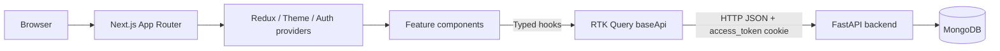

# UniScope Frontend

The UniScope frontend is a responsive Next.js application for discovering
university courses, comparing courses, browsing exam timelines, and managing
the UniScope catalog. It communicates directly with the separate FastAPI
backend and shares authentication state through an HTTP-only JWT cookie.

## Technology Stack

| Technology / library | Purpose |
|---|---|
| Next.js 16 | App Router, server/client rendering, layouts, route metadata, and production serving |
| React 19 | UI components, hooks, client-side rendering, and Suspense |
| TypeScript 5 | Strict type checking and typed API/domain models |
| Tailwind CSS 4 | Utility-first styling and global theme tokens |
| shadcn-style components | Base UI primitives adapted into reusable `components/ui` modules |
| Base UI (`@base-ui/react`) | Accessible primitives such as menus, dialogs, selects, and popovers |
| Redux Toolkit 2 | Application store and typed auth state |
| RTK Query / React Redux | API data fetching, request caching, mutations, and cache invalidation |
| `next-themes` | Light/dark/system theme selection |
| Lucide React | Icons |
| Embla Carousel | Horizontal carousel behavior |
| `cmdk` | Command-menu and searchable command UI primitives |
| `class-variance-authority` | Typed component variants |
| `cn` | Class-name composition through `lib/utils.ts` |
| `tw-animate-css` | Tailwind-compatible animation utilities |
| ESLint 9 | Next.js and TypeScript linting |
| pnpm | Workspace package management and reproducible dependency installation |

The source is organized as a feature-oriented Next.js application:

- `app/` owns routes and route layouts.
- `components/` owns feature and reusable UI components.
- `lib/features/` owns RTK Query APIs and auth state.
- `types/` mirrors the backend DTO and domain response shapes.
- `public/` contains static institute assets.

## System Architecture



`app/layout.tsx` is the root composition point. It installs the theme provider,
Redux store provider, authentication initializer, navbar, page content,
toast outlet, and footer. `StoreProvider` creates one Redux store per mounted
client application and registers the `auth` slice plus the shared RTK Query API
cache.

## Data and State Flow

### API layer

All backend requests pass through `lib/features/api/baseApi.ts`. The base query:

- uses `NEXT_PUBLIC_API_URL`, falling back to `http://localhost:8000`;
- sends JSON with `credentials: "include"` so the browser forwards cookies;
- sets a 30-second request timeout;
- dispatches `clearAuthenticatedUser()` after a `401`; and
- emits `auth-expired` to redirect the user to `/login`.

Feature API modules extend the same RTK Query API:

| Module | Backend resources |
|---|---|
| `auth.api.ts` | `/auth/login`, `/auth/logout`, `/auth/me` |
| `courses.api.ts` | Course listing, detail, create, update, delete, and source deletion |
| `compare.api.ts` | Similar courses and AI comparison summaries |
| `exams.api.ts` | Exam lists, timelines, and timeline refresh |
| `misc.api.ts` | Colleges, departments, platform statistics, and course scraping |
| `admin.api.ts` | Administrator listing and account mutations |

Typed DTOs in `types/` are used by these modules and the components that
consume their query/mutation hooks. RTK Query cache tags (`Course`, `Exam`,
`Stats`, `Admin`, and `Compare`) are invalidated after mutations, causing only
the relevant queries to refetch.

### Authentication and route protection

The backend sets an HTTP-only `access_token` cookie. The browser cannot read
the token directly; instead:

1. `AuthInitializer` calls `/auth/me` during application startup.
2. Its result updates the Redux auth slice with the current user.
3. `Navbar` and course/admin components use the resulting auth state.
4. `proxy.ts` redirects authenticated cookie holders away from `/login` and
   redirects unauthenticated cookie holders away from routes under `/admin`.
5. Logout calls `/auth/logout`, clears Redux auth state, and navigates home.

The client-side check is for UX; backend dependencies remain authoritative for
all protected API operations.

### Rendering and UI

Routes use the Next.js App Router. Interactive pages and components explicitly
declare `"use client"`; server-capable route wrappers can pass parameters and
generate metadata. Tailwind CSS classes and CSS custom properties in
`app/globals.css` provide the theme and responsive layout. `next-themes`
provides system-aware light/dark mode, while `next/font` loads Inter for body
text and Montserrat for headings.

Reusable primitives in `components/ui/` come from the configured shadcn-style
component setup (`components.json`). Feature components compose these primitives
into course tables, exam timelines, comparison cards, and admin forms.

## Routes

| Route | Purpose |
|---|---|
| `/` | UniScope landing page and platform statistics |
| `/courses` | Browse/filter courses and view details or edit controls |
| `/compare/[id]` | View a primary course and compare it with a similar course |
| `/exams` | Browse available exams and timelines |
| `/exams/[exam]` | Exam-specific timeline; optional `?year=YYYY` parameter |
| `/login` | Administrator sign-in |
| `/dashboard` | Administrator dashboard for accounts, course edits, and scraping |

`/dashboard` is the frontend admin area. Public course pages expose view and
comparison actions; authenticated users receive course-management controls.
Page rendering and mutations should still be enforced by backend auth because
the Next.js proxy is not a substitute for API authorization.

## Prerequisites

- Node.js 20.9 or newer
- pnpm (the repository includes `pnpm-lock.yaml`)
- A running UniScope FastAPI backend
- MongoDB and backend integrations where the requested feature requires them

Use the backend README for API prerequisites and environment setup. The
frontend does not create or start the MongoDB database.

## Installation and Run

From the repository root:

```bash
cd frontend
pnpm install
pnpm dev
```

Open <http://localhost:3000>.

The backend and frontend may be started in separate terminals:

```bash
# Terminal 1
cd backend
uv run fastapi dev

# Terminal 2
cd frontend
pnpm dev
```

The default backend origin is `http://localhost:8000`. When the API runs
elsewhere, set it before starting Next.js:

```bash
NEXT_PUBLIC_API_URL=http://localhost:8000 pnpm dev
```

For a persistent environment, create `frontend/.env.local`:

```env
NEXT_PUBLIC_API_URL=http://localhost:8000
```

Only variables prefixed with `NEXT_PUBLIC_` are exposed to browser code. The
access token itself should remain in the HTTP-only cookie created by FastAPI.

## Available Commands

Run these inside `frontend/`:

| Command | Action |
|---|---|
| `pnpm dev` | Start the Next.js development server |
| `pnpm build` | Create an optimized production build |
| `pnpm start` | Serve the previously built application |
| `pnpm lint` | Run Next.js Core Web Vitals and TypeScript ESLint rules |

A typical pre-commit check is:

```bash
pnpm lint
pnpm build
```

## Project Structure

```text
frontend/
├── app/
│   ├── layout.tsx          Root providers, navbar, content, footer
│   ├── page.tsx            Landing page
│   ├── courses/            Course browser
│   ├── compare/[id]/       Course comparison
│   ├── exams/              Exam browser and timeline routes
│   ├── login/              Administrator login
│   └── dashboard/          Administrator dashboard
├── components/
│   ├── admin/              Account, scrape, and course admin controls
│   ├── compare/            Comparison and AI summary cards
│   ├── courses/            Course table and detail forms
│   ├── exams/              Exam browser and timeline UI
│   ├── home/               Hero and platform statistics
│   ├── layout/             Navbar, providers, auth, dialogs
│   └── ui/                 Reusable UI primitives
├── lib/
│   ├── features/           RTK Query APIs and auth Redux slice
│   ├── hooks.ts            Typed Redux hooks
│   ├── store.ts            Redux store configuration
│   └── utils.ts            Shared class-name helper
├── types/                  API and frontend domain DTO types
├── public/images/          IIT institute logos
├── components.json         shadcn-style component registry/configuration
├── proxy.ts                Cookie-aware login/admin route proxy
├── next.config.ts          Next.js configuration
├── postcss.config.mjs      Tailwind CSS/PostCSS configuration
└── pnpm-lock.yaml          Locked dependency graph
```

## Backend Integration

The frontend expects the backend's DTO envelope and routes described in the
[backend README](../backend/README.md). It does not use Next.js route handlers
or server proxies for normal API calls: browser RTK Query hooks call FastAPI
with CORS-compatible credentials.

Key integration behaviors:

- `NEXT_PUBLIC_API_URL` controls the API origin.
- `credentials: "include"` allows the backend session cookie to be sent.
- RTK Query tags keep course, exam, admin, comparison, and stats data coherent.
- `401` responses clear Redux auth state and trigger login navigation.
- API errors are normalized by `lib/features/api/error.ts` before display.
- Form submissions and admin actions use mutations with loading/error feedback.
- Toast notifications provide consistent success and failure feedback.

## Styling and Components

Tailwind CSS 4 is imported and configured in `app/globals.css` and
`postcss.config.mjs`. Theme colors use CSS variables for both light and dark
mode, and components are composed from the Base UI-derived primitives in
`components/ui/`.

The component registry is configured in `components.json` with the `@/`
aliases from `tsconfig.json`, for example:

- `@/components/*`
- `@/lib/*`
- `@/types/*`

## Static Assets

Institute logos used by the home carousel and related UI are stored in
`public/images/`. They are referenced by paths such as
`/images/IIT Bombay Logo.png` and are served directly by Next.js.

## Development Notes

- Keep backend DTO changes synchronized with files under `types/` and feature
  API endpoints under `lib/features/`.
- Add a new RTK Query endpoint to the feature module that owns the resource,
  not directly to components.
- Add or update cache tags in `baseApi.ts` when creating invalidation
  relationships for a new resource.
- Keep `"use client"` only on components that need browser hooks or state.
- Run `pnpm lint` after component or route changes, and `pnpm build` before
  deploying to verify App Router and server/client boundaries.
